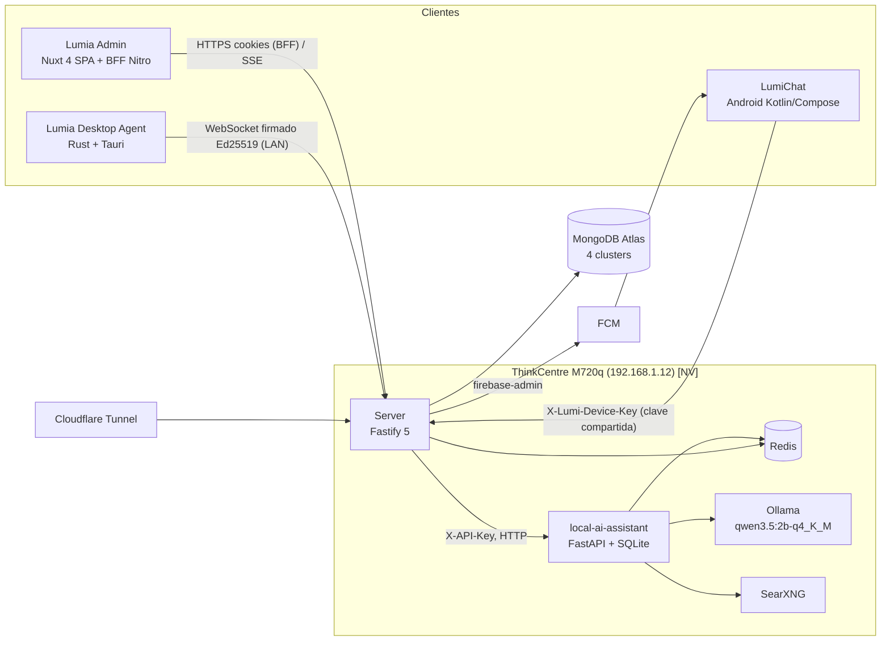

# Lumi 2.0 — Auditoría (Fase 0)

Fecha: 2026-11-27. Alcance: `server`, `local-ai-assistant`, `lumia-admin`, `lumichat`, `lumia-desktop-agent`
(como referencia) e infraestructura descrita en los repositorios. `lumia2.0` no se examinó ni modificó.

Método: lectura del código, configuración y Git de cada repositorio en
`D:\Proyectos programacion\`, y comprobaciones de solo lectura contra el Server desplegado
(`http://192.168.1.12:3001/health`). **No se modificó código, configuración ni bases de datos.**

Nivel de certeza: **[V]** verificado en código o ejecución · **[D]** solo en documentación ·
**[NV]** no verificado (falta acceso).

---

## 0. Estado de los repositorios

| Repositorio | Ruta | Rama | Cambios sin confirmar | Observación |
|---|---|---|---|---|
| server | `server/` | main (`adb92d7`) | 0 | Limpio [V] |
| local-ai-assistant | `local-ai-assistant/` | main (`c6825ab`) | 0 | Limpio [V] |
| lumia-admin | `lumia-admin/` | main (`bb5e496`) | 0 | Limpio [V] |
| **lumichat** | `lumichat/` | — | — | **No es un repositorio Git**: no hay historial ni forma de revertir [V] |
| lumia-desktop-agent | `lumia-desktop-agent/` | main (`d26b699`) | 22 | Trabajo de música en Brave sin confirmar; no se tocó [V] |
| lumia2.0 | `lumia2.0/` | main | 0 | Fuera de alcance [V] |

Los mensajes de commit son mayoritariamente «sad»: el historial no documenta qué cambió ni por qué.

---

## 1. Arquitectura actual



- **Server** es la autoridad: autenticación, permisos, herramientas de Lumi, automatizaciones,
  iniciativas, notificaciones, dispositivos de escritorio y auditoría de autenticación [V].
- **local-ai-assistant** interpreta (selector de herramientas, chat, generación, investigación web)
  y **guarda las conversaciones en SQLite** (`data/assistant.db`) [V].
- **Lumia Admin** es una SPA (`ssr: false`) con un BFF Nitro que guarda los tokens en cookies y
  reenvía al Server, incluido el SSE del chat [V].
- **LumiChat** solo recibe notificaciones FCM de pedidos nuevos [V].
- **Lumia Desktop Agent** ejecuta operaciones firmadas por el Server en el equipo [V].

---

## 2. Inventario de funcionalidades existentes

### 2.1 Server (Fastify 5.12, TypeScript, ~50 000 líneas) [V]

| Área | Implementado | Ubicación |
|---|---|---|
| Autenticación | JWT access/refresh, sesiones, 2FA (TOTP + códigos de respaldo), Google OAuth, limitador de intentos, auditoría de auth | `modules/identity/*` |
| Autorización | `AuthorizationService`: roles, permisos efectivos, **permisos temporales, delegaciones, overrides por usuario, condiciones**, caché 5 min, caducidad periódica | `modules/security/*` |
| Guardas | `authGuard`, `adminGuard`, `g(PERMISSION)` por ruta | `modules/admin/middleware`, `modules/identity/middleware` |
| Chat de Lumi | `/admin/lumi/chat` y `/chat/stream` (SSE), plan de turno con reglas sin modelo, selector en dos niveles, herramientas del catálogo | `routes/lumi.routes.ts`, `modules/lumi/turn`, `selector`, `tools` |
| Herramientas | Pedidos, productos, categorías, iniciativas, notificaciones y equipos de escritorio (`device.*`) | `modules/lumi/tools/catalog.ts` |
| Capacidades | Registro, pruebas y activación de herramientas con aprobación | `modules/lumi/capabilities/*`, colecciones `lumi_capabilit*` |
| Aprendizaje | Correcciones frase→herramienta con estados (detected/approved/rejected/deprecated) | `modules/lumi/learning`, `lumi_knowledge` |
| Contexto | Entidad activa por conversación | `lumi_context` |
| Recordatorios / tareas | `once` y `daily` con zona horaria; tipos reminder, routine, follow_up, initiative_review; ejecuciones idempotentes por ocurrencia; recuperación tras reinicio | `modules/lumi/automation/*`, `lumi_tasks` |
| Iniciativas | Detectores sobre pedidos, catálogo y rutinas; barrido cada 30 min con lock | `modules/lumi/initiatives/*` |
| Confirmaciones | Acciones pendientes con TTL (desktop); aprobaciones «no volver a preguntar» por tipo + destino | `lumi_pending_actions`, `desktop_approvals` |
| Equipos de escritorio | Registro, WebSocket autenticado, grants firmados de un solo uso, idempotencia, revocación, heartbeat | `modules/lumi/desktop-agent/*` |
| Notificaciones internas | Por usuario, leídas/no leídas, revisadas, SSE `/notifications/stream` | `modules/notifications/*` |
| Push FCM | Registro de dispositivos y aviso de pedido nuevo | `push.service.ts`, `routes/lumichat.routes.ts` |
| Métricas | Métricas por turno de Lumi | `lumi_turn_metrics` |
| Música | Búsqueda en YouTube, tarjeta de candidatos y `browser.media.play` en el equipo | `modules/lumi/music/*` |

Dependencias relevantes ya instaladas: `@fastify/websocket`, `firebase-admin`, `ioredis`, `mongodb`,
`zod`, `@fastify/rate-limit`, `pino`.

### 2.2 local-ai-assistant (FastAPI, Python, ~3 500 líneas) [V]

| Área | Estado |
|---|---|
| Modelo | `OLLAMA_MODEL=qwen3.5:2b-q4_K_M` (en `.env` local). En el M720q [NV] |
| Concurrencia | `ollama_max_concurrent=2`, cola con espera máx. 60 s, timeout 120 s |
| Contexto | Últimos 12 mensajes y máx. 6 000 caracteres; selector con `num_ctx` 4096. **Sin resumen ni compactación** |
| Endpoints | `/chat`, `/chat/stream`, `/chat/exchange`, `/conversations` (list/get/delete), `/generate`, `/select`, `/research`, `/search`, `/models`, `/usage`, `/health/dependencies` |
| Persistencia | SQLite: `conversations(id, title, user_ref)`, `messages(id autoincrement, role, content, references)`, `usage_events` |
| Seguridad | `X-API-Key` con `compare_digest`; falla cerrada (503) si no está configurada |
| Investigación | SearXNG + extracción, verificación de afirmaciones, citas y contradicciones |
| Recordatorios / iniciativas / memoria / planificación | **No existen aquí**: los recordatorios e iniciativas viven en el Server |

### 2.3 Lumia Admin [V]

- Nuxt **4.5.1**, Vue 3.5, Tailwind 3, Tabler Icons, vue-sonner, vee-validate + zod.
  **No usa Pinia ni Nuxt UI** (estado en composables).
- BFF Nitro como token handler: cookies httpOnly hacia el navegador, Bearer hacia el Server.
- Chat de Lumi: panel con streaming SSE, historial de conversaciones, tarjetas de confirmación de
  equipo, tarjetas de música con estados, referencias, valoraciones.
- Páginas de Lumi: automatizaciones, iniciativas, notificaciones, aprendizaje, capacidades, equipos de
  escritorio. Registro de auditoría y roles/usuarios.
- Identificadores: `conversationId` (de la IA Assistant) y clave de mensaje local del cliente
  (`m-<base36>-<n>`); los mensajes no tienen id de servidor.

### 2.4 LumiChat [V]

| Aspecto | Estado |
|---|---|
| Lenguaje / UI | Kotlin, Jetpack Compose, Material 3, Navigation Compose |
| SDK | `minSdk 26`, `targetSdk 35`, `compileSdk 35`, Java 17 |
| Tamaño | 18 archivos, ~1 800 líneas |
| Funciones | Recibir push FCM de pedido nuevo, listado local, botón a WhatsApp del cliente, ajustes |
| Red | OkHttp sin cliente WebSocket; URL por defecto `https://api.lumiadalistore.com` |
| Autenticación | **Ninguna de usuario**: clave compartida `X-Lumi-Device-Key` |
| Persistencia | DataStore (ajustes, clave, token FCM) y almacén local de notificaciones |
| Permisos | `INTERNET`, `POST_NOTIFICATIONS`. Sin micrófono, sin foreground service |
| Voz, chat, sesiones, presencia | **No existen** |

---

## 3. Funcionalidades incompletas o solo documentadas

| Elemento | Situación |
|---|---|
| Conversación multidispositivo | Las conversaciones son por `user_ref` en la IA Assistant; LumiChat no tiene usuario ni chat |
| Memoria de preferencias / largo plazo | Solo existe la memoria de interpretaciones (`lumi_knowledge`) |
| Bus de eventos de negocio | No existe: `order.service` llama directamente a `push.notifyPreOrderCreated`; las iniciativas consultan cada 30 min |
| Aprobaciones centralizadas | Tres mecanismos separados (acciones pendientes del chat, aprobaciones de escritorio, aprobaciones de producción) |
| Presencia de Lumi | No existe |
| Centro de actividad | Parcial: páginas separadas de automatizaciones, ejecuciones, iniciativas y notificaciones; sin vista unificada ni estado de Lumi |
| Controles de música (pausa, siguiente…) | Nombres declarados en `tool.types.ts` sin implementación; el sistema anterior se eliminó en `1cb2c97` (se implementan en una sesión aparte) |
| Métodos `music*` del cliente de la IA Assistant | El Server conserva llamadas a `/music/*`, endpoints eliminados de la IA Assistant en `c6825ab` |
| Pruebas del Server | 7 tests fallan desde antes de esta auditoría (catálogo de herramientas, menús del selector y enrutado de música) |

---

## 4. Dependencias

- **Server**: fastify 5.12, @fastify/{websocket, rate-limit, cookie, helmet, cors, swagger}, mongodb 6,
  ioredis 5, firebase-admin 14, jsonwebtoken, bcryptjs, otplib, zod 3, pino 10, sharp, nodemailer.
- **local-ai-assistant**: fastapi 0.162, starlette 1.7, uvicorn, httpx, redis-py, pydantic 2,
  sqlalchemy 2, trafilatura.
- **Lumia Admin**: nuxt 4.5, vue 3.5, tailwindcss 3.4, zod 3, vee-validate.
- **LumiChat**: Compose BOM 2024.12, Firebase BOM 33.7 (messaging), OkHttp 4.12, coroutines 1.9,
  DataStore 1.1.
- **Infra**: Ollama (systemd en el host), SearXNG (Docker), Redis 7, Cloudflare Tunnel, MongoDB Atlas.

---

## 5. Problemas encontrados

| # | Gravedad | Problema | Evidencia |
|---|---|---|---|
| P1 | Alta | LumiChat no está versionado | `lumichat/` sin `.git` |
| P2 | Alta | Push de pedido nuevo incluye **nombre y WhatsApp del cliente** en el payload FCM | `push.service.ts` → `customerName`, `whatsapp` |
| P3 | Alta | LumiChat se autentica con una **clave compartida** para todos los dispositivos; no hay usuario ni revocación por dispositivo | `routes/lumichat.routes.ts`, `DeviceRegistration.kt` |
| P4 | Media | LumiChat guarda la clave en DataStore en claro, con `allowBackup=true` y `usesCleartextTraffic=true` | `AndroidManifest.xml`, `SettingsRepository.kt` |
| P5 | Media | Sin Redis, los locks de automatizaciones e iniciativas se conceden siempre: solo es seguro con una instancia | `LocalAutomationLock`; `.env` local `REDIS_ENABLED=false` |
| P6 | Media | El hub SSE de notificaciones vive en memoria: con varias instancias se pierden eventos | `notification-stream.hub.ts` |
| P7 | Media | Mensajes sin id de cliente: un reintento de red puede duplicar un turno | `messages.id autoincrement`; chat sin clave de idempotencia |
| P8 | Media | Historial de conversación en SQLite de la IA Assistant, separado de MongoDB: copias, retención y propiedad fuera del Server | `data/assistant.db` |
| P9 | Media | Sin compactación del contexto: las conversaciones largas pierden todo lo anterior a 12 mensajes | `chat_history_messages=12` |
| P10 | Baja | Código muerto: métodos `music*` hacia endpoints inexistentes | `lumi-assistant.client.ts` |
| P11 | Baja | 7 tests fallan en la rama principal | `npx vitest run` |

---

## 6. Riesgos

| Riesgo | Impacto | Mitigación propuesta |
|---|---|---|
| RAM del M720q (8 GB) con Qwen + Redis + API + SearXNG | Cuelgues o swap | Mantener STT/TTS en Android; límite de concurrencia 1–2; medir antes de cada fase |
| Escucha continua en Android | Batería, rechazo de Play Store, privacidad | Foreground service tipo `microphone` solo en modo conversación; modo reposo sin captura |
| Wake word «Lumi» en español | Falsas activaciones / no detección | Prototipo y medición con sherpa-onnx KWS antes de comprometer la fase |
| Aprobaciones repartidas en tres sistemas | Reglas inconsistentes | Unificar bajo un `lumi-approvals` reutilizando `lumi_pending_actions` |
| Cambio de origen del historial (SQLite → Mongo) | Pérdida de conversaciones | Migración con verificación y doble lectura temporal |
| Sin versionado de LumiChat | Pérdida de trabajo | Inicializar Git antes de la Fase 1 |
| Datos personales en FCM | Exposición en el dispositivo y en Google | Payload solo con ids; detalle por API autenticada |

---

## 7. Componentes reutilizables

| Necesidad de Lumi 2.0 | Se reutiliza |
|---|---|
| Autenticación de LumiChat | Login del Server (JWT access/refresh, 2FA) — no crear otro |
| Permisos y autonomía supervisada | `AuthorizationService` (temporales, delegaciones, condiciones) |
| Identidad y canal de dispositivo | Modelo del Desktop Agent: registro, `desktop_devices`, WebSocket autenticado con heartbeat, reconexión, revocación, idempotencia |
| Scheduler | `AutomationScheduler` + `automation-worker` (persistencia, recuperación, idempotencia, lock Redis) |
| Proactividad | Motor de iniciativas + `lumi_initiatives` |
| Aprobaciones | `lumi_pending_actions` (acción + parámetros + TTL + id) como base del sistema central |
| Notificaciones | `notifications` (internas + SSE) y `push.service` (FCM) |
| Chat y herramientas | Plan de turno, selector, catálogo de herramientas y streaming SSE existentes |
| Memoria | `lumi_knowledge` (estados y procedencia) como patrón para preferencias |
| Auditoría | `auth-audit.repository` y `admin-activity` |

---

## 8. Duplicaciones

- Tres mecanismos de aprobación (chat de escritorio, «no volver a preguntar», producción).
- Dos almacenes de conversación posibles si se crea `lumi_conversations` sin retirar SQLite.
- Dos canales de tiempo real hacia clientes (SSE de chat y SSE de notificaciones) más el WebSocket
  del agente; la voz añadirá un tercero si no se diseña como extensión.
- Cliente `music*` del Server frente a endpoints eliminados.

---

## 9. Diferencias entre documentación y código

| Documentación / supuesto | Código real |
|---|---|
| Lumia Admin: Nuxt 3, Pinia, Nuxt UI | Nuxt 4.5.1, sin Pinia ni Nuxt UI |
| Lumia Admin «debe comunicarse directamente con Server» | Lo hace a través de su BFF Nitro (token handler); sigue llegando solo al Server |
| IA Assistant con recordatorios, iniciativas, planificación y memoria | Esas funciones están en el Server; la IA Assistant solo interpreta y genera |
| MongoDB y Redis locales en Docker (`docker-compose.yml`) | `.env` apunta a 4 clusters de MongoDB Atlas; `REDIS_ENABLED=false` en local |
| `cloudflare-tunnel.md`: túnel en host Windows | El servidor objetivo es Debian (M720q) |
| LumiChat «aplicación de comunicación con Lumi» | Solo recibe push de pedidos |
| Música: `music.*` (pausa, siguiente, cola…) | Eliminado; solo existe `device.play_music` |

---

## 10. Recomendaciones

1. **Antes de implementar**: versionar LumiChat; quitar PII del payload FCM; arreglar o retirar los 7
   tests rotos; retirar el código `music*` muerto; decidir Redis obligatorio en producción.
2. **Mantener una sola autoridad**: LumiChat se autentica con el login del Server y se registra como
   dispositivo con un esquema derivado del Desktop Agent (clave por dispositivo, revocable).
3. **Conversaciones en el Server** (MongoDB) como fuente de verdad, con id de mensaje generado por el
   cliente para idempotencia; la IA Assistant recibe el contexto ya preparado.
4. **Voz en el dispositivo**: wake word, STT y TTS en Android; el M720q solo hace la inferencia de
   texto.
5. **Eventos de negocio** con un bus interno sencillo dentro del Server (sin microservicios), sustituyendo
   las llamadas directas como `notifyPreOrderCreated`.
6. **Aprobaciones unificadas** sobre `lumi_pending_actions`, ligadas a acción + parámetros exactos.

---

## 11. Archivos afectados potencialmente

- Server: `routes/lumi.routes.ts`, `routes/lumichat.routes.ts`, `modules/notifications/*`,
  `modules/lumi/{automation,initiatives,actions,learning,infrastructure}/*`, `app.context.ts`,
  `modules/identity/*` (login de dispositivo móvil), nuevos módulos `modules/lumi/{conversation,memory,events,presence,approvals}`.
- local-ai-assistant: `api/v1/chat.py`, `services/assistant_service.py`,
  `repositories/conversation_repository.py`, prompts de sistema (personalidad).
- Lumia Admin: `app/features/lumi/*`, `server/api/admin/lumi/*`, nueva página de actividad.
- LumiChat: casi toda la app (autenticación, chat, voz, servicio en primer plano, WebSocket).

---

## 12. Dependencias externas

FCM (transporte de push), Cloudflare Tunnel (acceso público), MongoDB Atlas (datos de negocio),
SearXNG (búsqueda web, autoalojado), YouTube (música en el equipo). Ninguna de pago como requisito.
Nuevas previstas: sherpa-onnx (Android, Apache-2.0) para wake word / STT / TTS, sujeto a la
evaluación de la Fase 2.

---

## 13. Capacidad real de hardware

**[NV]**: el acceso SSH al M720q pide contraseña y no se pudo medir. Datos conocidos:

| Componente | Estimación | Fuente |
|---|---|---|
| CPU | i5-8400T, 6 núcleos, sin GPU | Enunciado |
| RAM total | 8 GB | Enunciado |
| Qwen 3.5 2B Q4_K_M | ~1,5–2,5 GB residentes con contexto 4–8k | Tamaño típico del modelo [NV] |
| API Fastify | límite 1 GB | `docker-compose.prod.yml` |
| Redis | límite 256 MB | `docker-compose.prod.yml` |
| MongoDB | En Atlas (no consume RAM local) | `.env` |
| STT/TTS en el servidor | Desaconsejado: competiría con Qwen por CPU | Análisis |

Para completar esta sección, ejecutar en el M720q y adjuntar la salida:

```bash
free -m; nproc; df -h /; docker stats --no-stream; ollama ps; ollama list; systemctl is-active ollama cloudflared
```
