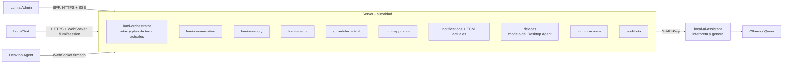

# Lumi 2.0 — Plan de implementación

Basado en [AUDIT.md](AUDIT.md) (2026-11-27). Nada de este plan está implementado. Cada fase se
inicia solo con aprobación explícita y no empieza mientras la anterior tenga errores críticos.

Estimaciones en días de trabajo de una persona, con pruebas incluidas. Son orientativas: dependen de
mediciones pendientes (RAM del M720q, rendimiento del móvil real).

---

## Arquitectura objetivo

Principios: una sola autoridad (Server); la IA Assistant no persiste decisiones ni concede permisos;
la voz se procesa en Android; LumiChat nunca habla con la IA Assistant ni con bases de datos.
Los «módulos» son carpetas dentro de `modules/lumi` del Server, no microservicios.

---

## Fase 0.5 — Correcciones previas (bloqueantes)

**Estado (2026-11-27): hecha, pendiente de tu revisión y de la prueba con Redis real.** Detalle en [CHANGELOG.md](CHANGELOG.md).

| Tarea | Repo | Est. |
|---|---|---|
| Inicializar Git en LumiChat (con `.gitignore` que excluya `google-services.json` y `local.properties`) | lumichat | 0,25 |
| Quitar nombre y WhatsApp del payload FCM (solo `orderId`/`orderNumber`); el detalle se pide por API autenticada | server, lumichat | 0,5 |
| Reparar o retirar los 7 tests rotos | server | 0,5 |
| Retirar los métodos `music*` muertos del cliente de la IA Assistant | server | 0,25 |
| Redis obligatorio en producción: fallar al arrancar si falta; locks y hub SSE por Redis | server | 0,75 |
| Medir el M720q (comandos en AUDIT §13) | infra | 0,25 |

**Aceptación:** suite del Server en verde; push sin PII verificado en un dispositivo real; LumiChat con
commit inicial.

---

## Fase 1 — Comunicación multidispositivo (≈ 8–10 días)

1. **Login de LumiChat con el Server** (mismos endpoints de identidad, 2FA incluido; solo
   administradores). Token de acceso
   en memoria, refresh en `EncryptedSharedPreferences`; `allowBackup=false`; solo HTTPS.
2. **Dispositivos móviles**: extender el modelo de `desktop_devices` (o colección hermana
   `lumi_devices`) con tipo `mobile`, dueño, token FCM, revocación y último contacto. Sustituye y
   **retira** la clave compartida `X-Lumi-Device-Key` dentro de esta fase.
3. **Conversaciones en el Server**: `lumi_conversations` y `lumi_messages` en MongoDB, con
   `clientMessageId` único por conversación (idempotencia). La IA Assistant deja de ser dueña del
   historial: recibe el contexto en cada turno. Migración desde `assistant.db` con verificación de
   recuentos.
4. **Canal en tiempo real**: WebSocket `/api/lumi/session` (protocolo versionado, heartbeat,
   reconexión, límites de tamaño y frecuencia, reutilizando el código del gateway del agente). Lumia
   Admin sigue con SSE por su BFF; ambos reciben los mismos eventos `message.*`.
5. **Presencia** mínima: `idle`, `thinking`, `working`, `waiting_approval`, `error`, derivada de los
   turnos reales.

**Aceptación (tests 1, 2, 3, 5, 6, 7, 9, 10, 17, 18 de la especificación):** un mensaje enviado desde
LumiChat aparece en Lumia Admin y viceversa; un reintento con el mismo `clientMessageId` no duplica;
revocar un dispositivo corta su sesión; el historial sobrevive a reiniciar el Server.

---

## Fase 2 — Voz local en Android (≈ 12–18 días, la más incierta)

1. **Prototipo de evaluación (decisión)**: medir en el móvil real
   - wake word «Lumi»: sherpa-onnx KWS (keywords en español) frente a un modelo propio;
     tasa de detección y falsas activaciones por hora;
   - STT: sherpa-onnx (Zipformer/Paraformer en español) frente a whisper.cpp (tiny/base);
     latencia, RAM, batería, precisión;
   - TTS: Android `TextToSpeech` (voz femenina del sistema) frente a Piper / sherpa-onnx VITS en
     español.
2. **Máquina de estados** explícita: `DISABLED → IDLE → WAKE_WORD_DETECTED → LISTENING →
   TRANSCRIBING → PROCESSING → SPEAKING (→ INTERRUPTED) → LISTENING`, más `RECONNECTING` y `ERROR`.
3. **Foreground service** tipo `microphone` solo en **modo conversación**, con notificación
   persistente y botón de detener. **Modo reposo** sin captura de audio.
4. **Barge-in** con `AcousticEchoCanceler` / `NoiseSuppressor` cuando el dispositivo los ofrezca y un
   VAD para cortar el TTS.
5. **Sesiones de voz** (`sessionId`, `conversationId`, `deviceId`, expiración, último mensaje)
   sobre el WebSocket de la Fase 1; el texto se envía como cualquier mensaje (`clientMessageId`).

**Aceptación (tests 4, 19, 20):** interrumpir una respuesta hablada en < 300 ms; en reposo el sistema
no mantiene el micrófono abierto (verificado con el indicador de privacidad de Android); tras un
cierre forzado no queda captura activa. Ningún audio sale del teléfono.

---

## Fase 3 — Notificaciones inteligentes (≈ 5–7 días)

Bus de eventos interno (`lumi-events`) → reglas de importancia → deduplicación (clave + ventana) →
notificación interna existente + FCM por dispositivo del usuario. Preferencias por tipo y horario de
silencio. Acciones rápidas: abrir conversación, ver detalle, posponer, marcar leída, aprobar/rechazar
(la acción abre la app y se valida en el Server; nunca se ejecuta solo por recibir el push).

**Aceptación (tests 8, 14):** notificación recibida con la app cerrada; dos eventos iguales en la
ventana generan una sola notificación; payload sin datos personales.

---

## Fase 4 — Autonomía supervisada (≈ 8–10 días)

- **Política de operaciones** en el Server: A (consulta), B (rutina con política aprobada),
  C (sensible: aprobación explícita). La categoría la declara cada herramienta en el catálogo, no Qwen.
- **lumi-approvals** sobre `lumi_pending_actions`: aprobación ligada a acción + hash de parámetros,
  un solo uso, expiración, aprobador, resultado y id de ejecución. Las aprobaciones de escritorio y
  producción migran a este modelo.
- **Automatizaciones** propuestas por Lumi en estado `proposed` hasta aprobación; reutiliza el
  scheduler actual (añadiendo historial de ejecución por automatización si falta).
- **Auditoría** de cada paso con correlación (usuario, conversación, mensaje, dispositivo, ejecución).

**Aceptación (tests 11, 12, 13, 15, 16):** aprobación caducada o reutilizada rechazada; tarea
recuperada tras reinicio; caída de Redis y de Ollama detectadas y comunicadas.

---

## Fase 5 — Memoria y personalidad (≈ 6–8 días)

- `lumi_memory` con tipos (preferencia, hecho, compromiso, decisión), procedencia, versión, estado y
  corrección; la IA propone y el Server valida (mismo patrón que `lumi_knowledge`).
- Compactación de conversaciones: resumen incremental guardado en el Server cuando se supera el
  límite de contexto.
- Perfil de personalidad versionado en el prompt de sistema de la IA Assistant.

**Aceptación:** una preferencia corregida reemplaza a la anterior con historial; la conversación larga
conserva compromisos pendientes tras compactar; ningún recuerdo sin procedencia.

---

## Fase 6 — Objetivos y planificación (≈ 8–12 días)

Objetivos con tareas derivadas, seguimiento y evaluación, reutilizando tareas, iniciativas y
aprobaciones. Centro de actividad completo en Lumia Admin (estado, tareas, aprobaciones,
automatizaciones, errores, dispositivos) con acciones reales.

---

## Contratos propuestos (no existen todavía)

Rutas reales actuales: `/api/admin/lumi/chat`, `/api/admin/lumi/chat/stream`,
`/api/admin/lumi/conversations[/:id]`, `/api/notifications/stream`,
`/api/lumichat/devices/{register,unregister}`. Propuestas nuevas (bajo `/api/lumi/`):

| Método | Ruta | Fase |
|---|---|---|
| POST | `/lumi/devices/register` (móvil, autenticado) | 1 |
| GET/POST | `/lumi/conversations`, `/lumi/conversations/:id/messages` | 1 |
| WS | `/lumi/session` | 1–2 |
| POST | `/lumi/voice/sessions/:id/end` | 2 |
| GET | `/lumi/activity` | 4/6 |
| GET, POST | `/lumi/approvals`, `/lumi/approvals/:id/resolve` | 4 |
| GET, POST | `/lumi/automations` | 4 |

Eventos del WebSocket: `voice.session.started|ended`, `voice.state.changed`, `message.submit`,
`message.received`, `assistant.thinking|response|interrupted|error`,
`assistant.tool.started|completed`, `assistant.approval.required`, `notification.created`,
`task.completed`. Sobre común `{ v, type, correlationId, conversationId?, messageId?, payload }`
validado con zod en el Server.

---

## Decisiones tomadas (2026-11-27)

| Decisión | Resultado | Consecuencia en el plan |
|---|---|---|
| Historial SQLite → MongoDB | **Sí** | Fase 1, punto 3: `lumi_conversations` / `lumi_messages` en el Server son la fuente de verdad; migración verificada de `assistant.db` |
| Redis en producción | **Obligatorio** | Fase 0.5: el Server no arranca en producción sin Redis; locks del scheduler e iniciativas y hub SSE pasan por Redis |
| Teléfono de pruebas | **OPPO Reno 5 Lite** | Fase 2 se mide en ese dispositivo. ColorOS restringe mucho el segundo plano: hay que documentar inicio automático, optimización de batería y bloqueo en recientes, y probar el foreground service en él. Versión de Android y RAM exactas: confirmar en el propio teléfono |
| Usuarios de LumiChat | **Solo administradores** | Fase 1: el login de LumiChat exige rol administrativo (mismo `adminGuard` y permiso `lumi.use` que Lumia Admin); otros roles reciben 403 |
| Clave compartida `X-Lumi-Device-Key` | **Retirada en la Fase 1** | Fase 1: el registro de dispositivo pasa a ser autenticado por usuario; las rutas `/lumichat/devices/*` con clave compartida se eliminan al cerrar la fase (sin periodo en paralelo) |

## Orden recomendado

0.5 → 1 → 3 → 2 → 4 → 5 → 6. Las notificaciones (Fase 3) dependen solo de la Fase 1 y dan valor
pronto; la voz (Fase 2) es la de mayor riesgo y conviene empezarla con el prototipo de medición en
paralelo a la Fase 3.

## Cómo revertir

Cada fase en su rama y sus commits; colecciones nuevas sin tocar las existentes hasta la migración;
migraciones con copia previa y script inverso; flags de activación por fase en el Server.
